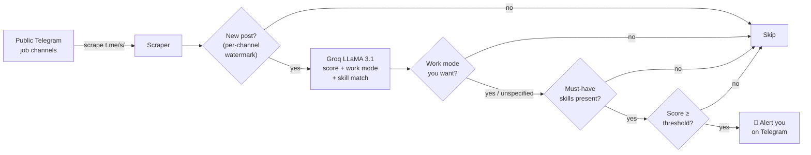

<div align="center">

# 🎯 Telegram Job Matcher Bot

**An autonomous Telegram bot that watches public job channels and pings you only when a posting actually matches your CV — scored by AI.**

[](https://www.python.org/)
[](https://docs.aiogram.dev/)
[](https://groq.com/)
[](#-testing)
[](LICENSE)

</div>

---

## ✨ What it does

Scrolling dozens of Telegram job channels and re-reading the same reposts is tedious. This bot does it for you: it continuously scrapes the channels you subscribe to, hashes out duplicates, and asks **Groq's LLaMA 3.1** to score each new posting against *your* CV. You only get a message when the match clears the threshold you set.

```
🎯 New Match Found! (87%)

Reason: Strong overlap on Python, asyncio and PostgreSQL; the
posting's "distributed systems" requirement matches your Kafka project.

🔗 View Original Post
--- Preview ---
We are hiring a Senior Backend Engineer (Remote) …
```

## 🧠 How it works



A background loop sweeps every subscribed channel on an interval. Newness is tracked with a **per-channel high-water mark** (the newest Telegram post id already handled), which means:

- **No first-run spam** — when you add a channel, its existing backlog is skipped; you're only alerted on posts published *after* you subscribe.
- **No missed posts** — if you subscribe before uploading a CV, incoming posts are *held* (not consumed) until your CV exists, then scored.
- **Login-free & ban-safe** — it reads Telegram's public web preview (`t.me/s/<channel>`), so there's no account to get blocked.

## 🚀 Features

| | |
|---|---|
| 🤖 **AI matching** | Groq `llama-3.1-8b-instant` scores each posting 0–100 with a human-readable reason |
| 🏠 **Work-mode filter** | Want remote only? On-site jobs never reach you — no matter how well they score |
| 🛠️ **Skills filter** | Skills are auto-extracted from your CV, then fully editable. Star any as ⭐ must-have to require them |
| 📄 **Flexible CV input** | Paste text/LaTeX or upload a `.txt` / `.tex` / `.md` file (validated, never written to disk) |
| 🎚️ **Custom threshold** | Pick your match sensitivity from 15% to 90% via an inline keyboard |
| 📡 **Channel management** | Add/remove channels; new channels are verified to exist before saving |
| 🧹 **Smart dedup** | Per-channel watermark + repost suppression, with automatic history pruning |
| 🛡️ **Resilient** | Retry/backoff on network hiccups, per-channel failure isolation, graceful shutdown |
| 🐳 **Deploy-ready** | One-command Docker image with a persistent volume for the database |

### 🎛️ How the filters behave

- **Work mode is strict.** Choose `Remote` and only remote roles get through — hybrid and on-site are dropped even at a 100% score.
- **Unspecified is never dropped.** Plenty of posts never say how the work is done. Those always reach you, labelled *"❓ Not specified"*, so you don't lose good jobs to silence.
- **Skills sharpen scoring by default.** Your curated list tells the AI what you actually care about now — useful when your CV lists things you'd rather not do again. Only skills you ⭐ star become hard requirements.

## 📦 Getting started

### 1. Install

```bash
git clone https://github.com/Nerses01/telegram-job-matcher.git
cd telegram-job-matcher
pip install -r requirements.txt
```

### 2. Configure

Copy the template and fill in your two secrets:

```bash
cp .env.example .env
```

| Variable | Where to get it |
|---|---|
| `TELEGRAM_BOT_TOKEN` | [@BotFather](https://t.me/BotFather) → `/newbot` |
| `GROQ_API_KEY` | [console.groq.com/keys](https://console.groq.com/keys) (free tier) |

> The app **fails fast** with a clear message if either secret is missing, so you'll never start half-configured.

### 3. Run

```bash
python main.py
```

Then open your bot in Telegram and send `/start`.

## 💬 Bot commands

| Command | Description |
|---|---|
| `/start` | Register and get going |
| `/cv` | Set your CV (paste text/LaTeX or upload a file) — auto-extracts your skills |
| `/skills` | Review the skills used for matching; add, remove, or ⭐ star must-haves |
| `/workmode` | Filter by remote / on-site / hybrid |
| `/add_channel` | Add a public channel to monitor |
| `/rm_channel` | Remove a channel (inline menu) |
| `/list` | List the channels you track |
| `/threshold` | Show your current match threshold |
| `/set_threshold` | Change your match threshold |
| `/stats` | Summary of your configuration |
| `/cancel` | Abort the current action |
| `/help` | Show all commands |

## 🧪 Testing

```bash
pip install -r requirements-dev.txt
pytest
```

The suite covers the database layer, the scraper (against an HTML fixture), the
AI result parsing/clamping, and — most importantly — **regression tests for the
deduplication logic** (no first-run burst; held-then-scored after a late CV upload),
the **filter gates** (a 100%-scoring on-site job is suppressed for a remote-only
user, while an unspecified one still alerts), and **schema-migration safety** on a
database created before the filters existed.

You can also smoke-test components in isolation:

```bash
python scraper.py     # scrape a live sample channel
python ai_engine.py   # score a sample CV/job (needs GROQ_API_KEY)
```

## 🐳 Docker

```bash
docker build -t telegram-job-matcher .
docker run --env-file .env -v tg_data:/data telegram-job-matcher
```

The SQLite database lives in the `/data` volume, so it survives restarts.

## 🗂️ Project structure

```
├── main.py         # entry point: runs the bot + monitor loop concurrently
├── bot.py          # aiogram handlers, FSM, inline keyboards
├── scraper.py      # login-free t.me/s/ scraping (httpx + BeautifulSoup)
├── ai_engine.py    # Groq client + match scoring/validation
├── database.py     # aiosqlite persistence (users, subs, watermark, dedup)
├── config.py       # tunables, validated secrets, shared helpers
├── tests/          # pytest suite (unit + dedup regression tests)
├── Dockerfile
└── requirements.txt
```

## 🛠️ Tech stack

`Python` · `aiogram 3` · `asyncio` · `aiosqlite` · `httpx` · `BeautifulSoup` · `Groq (LLaMA 3.1)`

## 📄 License

Released under the [MIT License](LICENSE).

---

<div align="center">
<sub>Built with ☕ and asyncio.</sub>
</div>
